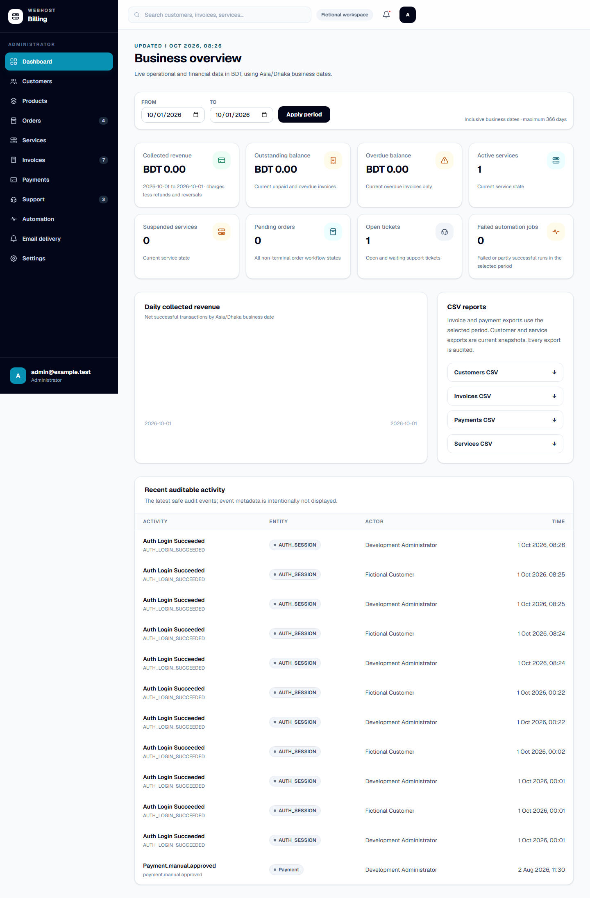

# Webhost Billing

[](https://github.com/ebit101/webhost-billing/actions/workflows/ci.yml)
[](https://github.com/ebit101/webhost-billing/actions/workflows/codeql.yml)
[](LICENSE)

Webhost Billing is an AI-assisted, open-source technical foundation for billing and
hosting-service management at a single web-hosting business. It focuses on customer
accounts, products, orders, invoices, payments, hosting provisioning, renewals, and
support without reproducing the worldwide feature set of WHMCS.

> [!WARNING]
> **Technical preview — not fit for live use.** There is no stable `1.0` release.
> Do not use real customer data, credentials, payments, email delivery, or hosting
> provisioning. Evaluate only with fictional data and disabled/fake external
> providers. Production remains `NO-GO` until every acceptance gate documented under
> `docs/` has passed.

## Latest development status

Updated 2026-11-01, through Command 160. These capabilities describe current `main`;
the immutable `v0.1.0-alpha.1` evaluation release is an older source snapshot.

- **Client workspace:** Summary, Profile, Products/services, Domains, Orders,
  Invoices, Payments, Support and Email history retain the selected client.
  Record collections use compact tables with scoped search, filters, pagination
  and separate details where implemented. Product groups organize the catalogue.
- **Domain inventory:** The administrator list has database pagination, literal
  client/domain search, status/origin filters, complete counts and compact summaries.
  Links retain client ownership, and browsing does not contact a registrar. See
  [the inventory contract](docs/DOMAIN_INVENTORY.md) for compatibility and limits.
- **Billing and orders:** Administrators can combine hosting and an annual domain
  service in one order and invoice. An existing domain must be linked through
  registrar-account ownership verification. Registration dispatch defaults off;
  billing an existing domain does not register, renew or change it. Manual payment
  verification and deliberate fulfillment remain separate steps.
- **Account access:** Administrator MFA remains required for every new sign-in.
  Remember this device extends the signed-in session without bypassing MFA.
  Signed-in `/login` visitors return to their administrator or customer workspace.
  Administrators can resend customer verification emails and see saved staff names.
- **Invoices and communication:** Invoice documents include business contact and
  manual payment instructions, with a consistent persisted due calendar date.
  Admin and Client notification lists/history and important-alert-only WhatsApp
  handling are implemented; delivery is disabled by default. Queueing or provider
  acceptance is not proof of inbox receipt.
- **Hosting safeguards:** Explicit website/email preservation, separate payment
  and provisioning states, idempotent account creation, at most five safe attempts
  and held uncertain results prevent blind creation retries. A new submission key
  cannot reset creation history or bypass reconciliation.

Command 156 passed 62 fictional API/database lifecycle cases using fake providers,
including combined billing, sample-payment review, successful hosting, temporary
retry and a response lost after account creation. Command 157 deployed the validated
retry fix `6e5856facabdfa336fff697dae622b63f6610cdd` to operator-controlled staging
after backup verification, with installed-guard smoke tests and read-only acceptance.
Staging SMTP remains active; payment, real hosting, registrar and WhatsApp providers
remain disabled. This evidence does not establish production readiness or actual
bank settlement, and staging is not a public evaluation target.

See the [capability matrix](docs/CAPABILITY_MATRIX.md),
[latest command reports](docs/PROGRESS.md),
[staging deployment record](docs/STAGING_DEPLOYMENT.md) and
[unreleased changelog](CHANGELOG.md#unreleased) for scope, evidence and remaining gates.

## Human-directed Codex workflow

This repository is being developed through a documented, command-by-command workflow
in which OpenAI Codex assists with implementation, testing, review, and documentation.
Every accepted change is human-reviewed. The human maintainer defines the product,
authorizes each bounded command, reviews the evidence, controls releases, and retains
responsibility for every decision.

This describes how the project is developed; the application does not currently ship
an AI runtime or AI-powered billing feature. Webhost Billing is an independent project
and is not affiliated with or endorsed by OpenAI. See
[`docs/CODEX_WORKFLOW.md`](docs/CODEX_WORKFLOW.md) for the work path, evidence model,
and authority boundaries.

## Architecture

```text
apps/api       NestJS REST API
apps/web       Next.js App Router frontend
apps/worker    NestJS worker application context
               and dedicated scheduler entry point
packages/config
packages/database
packages/queue
packages/shared
```

The workspace uses Node.js 24 LTS, pnpm, TypeScript, PostgreSQL, Prisma, Redis, and BullMQ.

## Requirements

- Node.js 24 LTS and pinned pnpm 11.22.0, or Docker
- Git

## Safe local evaluation

With Node.js 24/Corepack and Docker running, start the complete fictional-data demo:

```bash
corepack pnpm demo:doctor
corepack pnpm demo:up
```

The read-only preflight reports Docker/Compose versions, Engine availability,
loopback port `3100`, and whether the ignored runtime file exists without printing
its values or changing local state. `demo:up` then prints generated administrator
and customer logins and exposes only
`http://localhost:3100` on loopback. Application and data services use an internal
network; only the hardened gateway joins a dedicated ingress bridge. The stack uses
separate volumes and disabled external providers. Stop it with
`corepack pnpm demo:down`. With the healthy demo running and Playwright Chromium
installed, `corepack pnpm demo:smoke` verifies the principal evaluator paths without
changing business or Docker state. For a destructive return to first-run fictional
state, follow the exact confirmation-gated reset procedure in the walkthrough; never
use a generic Docker prune.



Follow the five-minute [`safe evaluation walkthrough`](docs/SAFE_EVALUATION_DEMO.md),
check the [`capability and limitation matrix`](docs/CAPABILITY_MATRIX.md), or review
the current availability and completed examples in the
[`contributor starter-issue catalogue`](docs/STARTER_ISSUES.md). The demo does not
change the production `NO-GO` decision.

## Install and validate

```bash
corepack enable
corepack prepare pnpm@11.22.0 --activate
pnpm install --frozen-lockfile
pnpm format:check
pnpm lint
pnpm typecheck
pnpm test
pnpm --filter @webhost-billing/web exec playwright install chromium
pnpm test:e2e
pnpm build
```

Never commit populated `.env` files. Copy `.env.example` only when local configuration is needed.

Start the local PostgreSQL and Redis services with:

```bash
cp .env.example .env
docker compose up --detach --wait postgres redis
```

See `docs/DEVELOPMENT.md` for setup, health checks, connectivity, shutdown, and safe reset procedures.

## Project status and scope

The application is intentionally a focused modular monolith for one hosting business.
It is not a multi-tenant reseller platform, a tax engine, or a drop-in WHMCS clone.
Payment and hosting integrations are disabled until their credentials and operating
boundaries are explicitly configured. Publishing this source does not make the hosted
demonstration or staging instance a public test target.

See `docs/PUBLIC_RELEASE.md` for release channels, compatibility expectations,
distribution checks, and maintainer procedures.

## Administrator access

Each staff member uses an individual administrator account with one fixed role.

| Role               | Permitted work                                                                                                  |
| ------------------ | --------------------------------------------------------------------------------------------------------------- |
| Full administrator | All existing administrative operations, including staff management; existing business confirmations still apply |
| Billing operator   | Read customer billing context, manage invoices, record and verify manual payments                               |
| Support operator   | View, reply to and manage tickets in the existing single support queue                                          |

Billing/support operators cannot change settings, manage integration credentials,
operate hosting, run automation, export reports or manage staff. Refunds and
reversals remain full-administrator-only. Integration credentials are not staff
accounts; there is no API-user role or custom permission/department builder.

Full administrators use **Administrators** in the navigation to invite staff or
change access. Staff changes require two-factor authentication. Invitations queue
separate one-time verification and password-setup emails through the existing
delivery pipeline; queueing is not proof of delivery. The recipient must complete
both steps and enroll in two-factor authentication before restricted work is allowed.
Expired invitations can be resent. Disabled accounts have their outstanding links
consumed and cannot be reactivated by an old verification link.

Changing access revokes existing sessions/challenges. Administrators cannot disable
or demote themselves, and concurrent changes cannot remove the last usable full
administrator through staff management. Existing profiles migrate to full
administrator without changing customer roles or financial records. Install the
migration with matching API/web builds; source publication does not apply it to a
live installation or authorize staff creation/deployment.

## Project documentation

- `HOSTING_BILLING_SYSTEM_PLAN.md` — product requirements and architecture
- `CODEX_DEVELOPMENT_COMMANDS.md` — ordered development commands
- `docs/DECISIONS.md` — durable architecture decisions
- `docs/API_CONTRACTS.md` — shared runtime contracts, money serialization, and API errors
- `docs/AUTHENTICATION.md` — authentication flows, cookies, CSRF, authorization, and sessions
- `docs/SECURITY_HARDENING.md` — Command 24 controls, verification evidence, residual risks, and production checklist
- `docs/CRITICAL_BUSINESS_INVARIANTS.md` — Command 25 invariant matrix, focused test command, and failure interpretation
- `docs/END_TO_END_TESTING.md` — isolated Playwright lifecycle, test-data boundaries, failure artifacts, and local execution
- `docs/OBSERVABILITY.md` — structured logging, correlation, health/readiness, operational metrics, and administrator alert policy
- `docs/BACKUP_AND_RECOVERY.md` — encrypted PostgreSQL backups, isolated restores, migration recovery, secrets recovery, and disaster checklist
- `docs/PRODUCTION_READINESS_REVIEW.md` — current operating gates, validated recovery repairs, workload limits and remaining production blockers
- `docs/TOOLCHAIN_SECURITY_REMEDIATION.md` — reviewed build-tool updates, enforced source patch, installed regressions and raw audit applicability
- `docs/PRODUCTION_DEPLOYMENT.md` — production Compose/Nginx topology, HTTPS, secrets, storage, migration, deployment, and rollback runbooks
- `docs/CODEX_WORKFLOW.md` — human-directed AI-assisted development path, evidence, authority, and attribution
- `docs/SAFE_EVALUATION_DEMO.md` — isolated one-command fictional demo, walkthrough, commands, and screenshots
- `docs/CAPABILITY_MATRIX.md` — evaluator-visible features, disabled integrations, limitations, and non-goals
- `docs/STARTER_ISSUES.md` — bounded contribution tasks with acceptance and validation criteria
- `docs/CONTRIBUTOR_PATHS.md` — source, focused-test, documentation, validation, and invariant map for small changes
- `docs/CUSTOMER_MANAGEMENT.md` — customer API, authorization, account-access rules, and interfaces
- `docs/PRODUCTS_AND_PRICING.md` — product lifecycle, versioned prices, public catalogue, and selection flow
- `docs/ORDER_CREATION.md` — authoritative checkout, idempotency, snapshots, numbering, and order states
- `docs/INVOICES.md` — calculation rules, drafts, issued history, identity snapshots, states, printing, and PDF downloads
- `docs/MANUAL_PAYMENTS.md` — manual proof, review, settlement, concurrency, refunds, and reversals
- `docs/PAYMENT_GATEWAYS.md` — bKash/SSLCOMMERZ sandbox setup, gateway contracts, callbacks, reconciliation, replay protection, and outbox handoff
- `docs/SERVICES.md` — service creation, snapshots, lifecycle, authorization, and administrator/customer workflows
- `docs/HOSTING_PANELS.md` — real cPanel/WHM API-token setup, encrypted credentials, operation safety, manual verification, and separate UK2Group scope
- `docs/LOGICBOXES_REGISTRAR_IMPLEMENTATION.md` — complete fictional StarGate/UK2 registration workflow, mocked official contracts, recovery and genuine-demo prerequisites
- `docs/BACKGROUND_JOBS.md` — BullMQ queues, transactional outbox dispatch, retries, failure visibility, and worker shutdown
- `docs/EMAIL_NOTIFICATIONS.md` — queued SMTP delivery, templates, preview files, retries, secret boundaries, and operations
- `docs/RENEWAL_AUTOMATION.md` — renewal policy, scheduler locking, invoice/reminder lifecycle, and safe cPanel suspension/reactivation
- `docs/SUPPORT_TICKETS.md` — customer/admin ticket workflows, ownership, plain-text policy, audit, and reply emails
- `docs/DASHBOARDS_AND_REPORTS.md` — live metric definitions, business-date periods, audited CSV exports, and report safety
- `docs/DATABASE.md` — schema, migration, deletion, and seed-data decisions
- `docs/DEVELOPMENT.md` — local infrastructure and application setup
- `docs/FRONTEND_DESIGN_SYSTEM.md` — application shells, design tokens, responsive behavior, and UI components
- `docs/PROGRESS.md` — command-by-command implementation reports

## Contributing and support

- Read `CONTRIBUTING.md` before proposing a change.
- Use GitHub Issues for reproducible bugs and setup questions; see `SUPPORT.md`.
- Report vulnerabilities privately according to `SECURITY.md`.
- Community participation follows `CODE_OF_CONDUCT.md`.
- Project decisions and maintainer responsibilities are described in `GOVERNANCE.md`.

## License

Webhost Billing is licensed under the [Apache License 2.0](LICENSE). Third-party
dependencies and assets retain their own licenses; see `THIRD_PARTY_NOTICES.md`.
The license does not grant permission to imply endorsement by the project or present
a modified distribution as an official Webhost Billing release.
